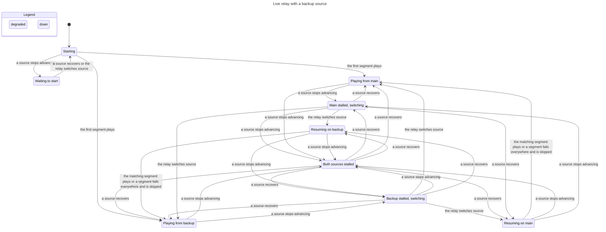
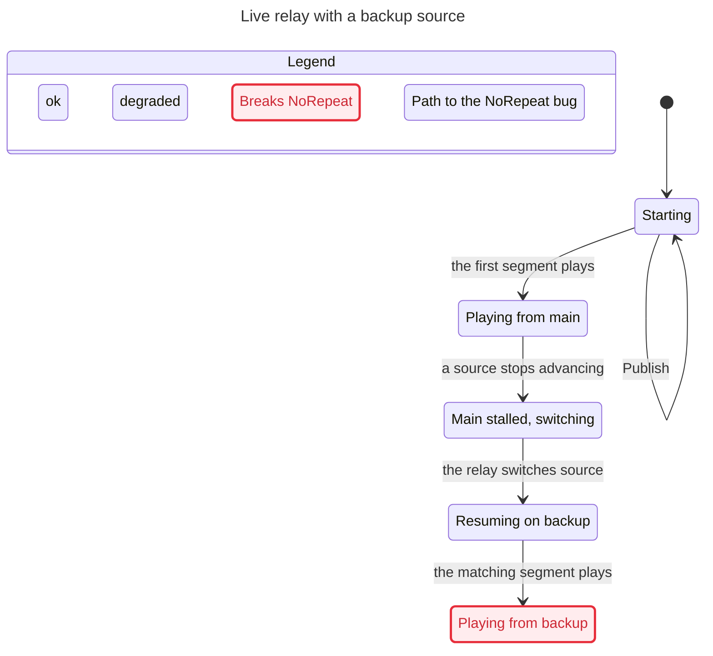
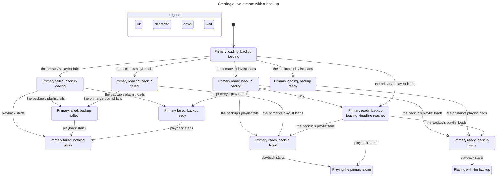

# Live relay failover

When live playback has a backup source, `sportscli/relay.py` (class `Merged`) switches
between the two sources and `sportscli/merge.py` (class `Timeline`) decides which segment
to play next. The promise: **the player never sees a moment of the game twice, never
goes back, and only jumps ahead past a segment that no source could supply.**

`verification/relay/RelayFailover.tla` models that in TLA+ and `verification/relay/check.sh`
model-checks it (TLC, every order of segments published, sources failing and recovering,
switches and skips, up to 6 segments with the backup one segment behind).

| Sources share | Verdict |
|---|---|
| Video timestamps (same encoder) | Holds: the relay realigns to the next moment or waits |
| Segment names | **Can repeat** when the backup has not yet published the segment that was playing |
| Program dates | **Can repeat** when the backup has not yet published the next moment |
| Nothing | Can repeat or skip ahead |

The repeats come from one fallback: when the new source has not published the matching
segment yet, `Timeline.plan()` keeps the same distance from the live edge instead of
waiting. `tests/test_relay_model.py` replays these paths on the real code.

## Slow sources and switching back

`Merged.steer()` makes every switch decision. Besides a stalled source, it leaves one whose last two
segments each took longer to download than they last: the playlist still advances, so the source looks
healthy, but the player's buffer drains. A source left that way is not switched back to for speed for five
minutes. Once the chosen source has been healthy for 30 s, playback returns to it, but only from a backup
whose timestamps matched it (`Merged.exact`), because only then is the return exact. The model's
`Return` action covers that move, and every rule still holds.

On a live NBA game (2026-11-04, StreamFree 1080p with its 540p copy as backup), a source made slower than
real time used to stall mpv about 10 s in 75 s with no switch, and a 15 s outage left playback on 540p for
the rest of the game. With `steer()` both switch without a stall, repeat or skip.

## End-to-end drill and a live game

`verification/relay/drill.py` cuts a test stream, serves it as two live HLS sources on localhost,
merges them with the real relay, breaks the primary 20 s in, and measures what a player is offered
(seconds played twice, seconds skipped, longest wait) and, with `--mpv`, how headless mpv plays it.
Segment contents are known from how they were cut, so the numbers are in seconds of game time.

| Backup is | Primary fails by | Repeated | Skipped | Longest wait | mpv stalls |
|---|---|---|---|---|---|
| Same stream, same names | going down | 0 s | 0 s | 2.3 s | 0 |
| Same stream, renamed segments | going down | 0 s | 0 s | 2.5 s | 0 |
| Same stream | freezing, or its segments vanishing | 0 s | 0 s | 2.5 to 5 s | 0 |
| Other encoder | going down | 1.2 s | 0 s | 2.0 s | 0 |
| Other encoder | freezing | 0 s | 0.8 s | 4.1 s | 0 |
| Other encoder, 3 segments behind | going down | 5.2 s | 0 s | 2.0 s | 0 |
| Other encoder listed first, same stream second | going down | 0 s | 0 s | 2.5 s | 0 |

Playback never froze in any case. When the sources share a clock the switch is invisible. With
another encoder the relay keeps the live-edge distance, so the viewer sees 1 to 5 s repeat or a
short skip, and mpv logs a timestamp jump at the seam.

A live NBA game (probed read-only on 2026-11-04, 6 working sources, 15 pairs) shows which case is
common. Only two pairs could be spliced exactly: two NTV servers on the same clock with different
segment names, and StreamFree with NBA Monster, which share every segment name 4 s apart. The other
pairs differ by hundreds to tens of thousands of seconds, so a backup picked at random usually
falls in the "other encoder" rows.

So the app no longer takes the first backup that resolves. `App.merge_backup` waits up to 3 s after
the first one for the rest, hands every candidate to `Relay.add_merged`, and `Merged.prepare` keeps
the one that lines up with the primary (shared segment names, program dates within 30 s, or
transport-stream clocks within 90 s), else the first. The last row above shows the effect: before
this, the drill took the other-encoder source and replayed 1.2 s.

## How the relay moves between states

Rendered from the model with 4 segments; every rule holds when sources share video timestamps.

## The repeat, as a path

With shared segment names and a backup one segment behind: play from main, main stalls,
switch, and the backup's newest segment is the one already played.

## Starting with several backups

`verification/relay/BackupChoice.tla` models the moment before any of the above: every source's playlist loads at once, and one backup is kept. It checks four promises over three backups of every kind, loading or failing in every order around the deadline (124,416 states):

- The stream never starts on a primary that did not load.
- A ready primary is never kept waiting past the deadline (`Merged.PREPARE_WAIT`, six seconds) for a backup that has not answered.
- The backup kept had loaded in time. A late one is never used.
- When a loaded backup lines up with the primary, the first such backup offered is kept. Otherwise the first that loaded is.

Two broken variants prove the check can fail: the old start, which waited for every playlist, breaks the second promise, and keeping the first loaded backup without comparing breaks the fourth. `tests/test_backup_choice_model.py` holds the real code to the same rule in 1,884 cases.

With one backup, every way the two playlists can arrive, drawn from the model by the `/statechart` skill (`verification/relay/choice-chart.cfg` and `choice-view.mjs`). Waiting past the deadline never happens: the primary starts alone and a backup that loads later is not used.

