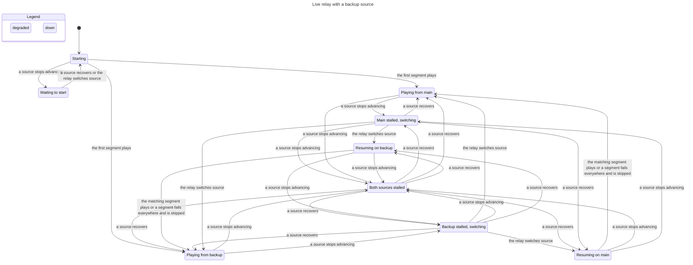
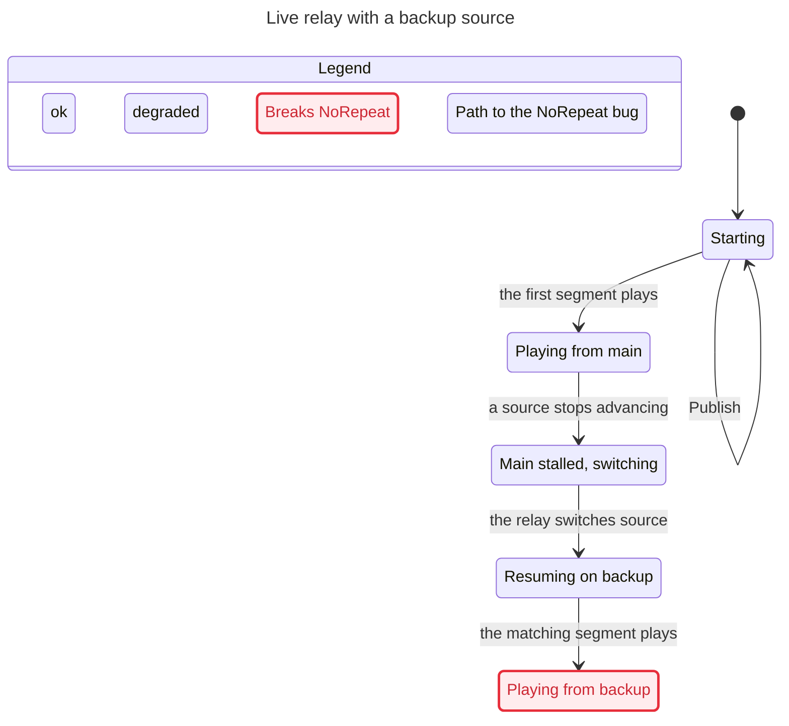

# Live relay failover

When live playback has a backup source, `sportscli/relay.py` (class `Merged`) switches
between the two sources and `sportscli/merge.py` (class `Timeline`) decides which segment
to play next. The promise: **the player never sees a moment of the game twice, never
goes back, and only jumps ahead past a segment that no source could supply.**

`verification/relay/RelayFailover.tla` models that in TLA+ and `verification/relay/check.sh`
model-checks it (TLC, every order of segments published, sources failing and recovering,
switches and skips, up to 6 segments with the backup one segment behind).

| Sources share | Verdict |
|---|---|
| Video timestamps (same encoder) | Holds: the relay realigns to the next moment or waits |
| Segment names | **Can repeat** when the backup has not yet published the segment that was playing |
| Program dates | **Can repeat** when the backup has not yet published the next moment |
| Nothing | Can repeat or skip ahead |

The repeats come from one fallback: when the new source has not published the matching
segment yet, `Timeline.plan()` keeps the same distance from the live edge instead of
waiting. `tests/test_relay_model.py` replays these paths on the real code.

## End-to-end drill and a live game

`verification/relay/drill.py` cuts a test stream, serves it as two live HLS sources on localhost,
merges them with the real relay, breaks the primary 20 s in, and measures what a player is offered
(seconds played twice, seconds skipped, longest wait) and, with `--mpv`, how headless mpv plays it.
Segment contents are known from how they were cut, so the numbers are in seconds of game time.

| Backup is | Primary fails by | Repeated | Skipped | Longest wait | mpv stalls |
|---|---|---|---|---|---|
| Same stream, same names | going down | 0 s | 0 s | 2.3 s | 0 |
| Same stream, renamed segments | going down | 0 s | 0 s | 2.5 s | 0 |
| Same stream | freezing, or its segments vanishing | 0 s | 0 s | 2.5 to 5 s | 0 |
| Other encoder | going down | 1.2 s | 0 s | 2.0 s | 0 |
| Other encoder | freezing | 0 s | 0.8 s | 4.1 s | 0 |
| Other encoder, 3 segments behind | going down | 5.2 s | 0 s | 2.0 s | 0 |

Playback never froze in any case. When the sources share a clock the switch is invisible. With
another encoder the relay keeps the live-edge distance, so the viewer sees 1 to 5 s repeat or a
short skip, and mpv logs a timestamp jump at the seam.

A live NBA game (probed read-only on 2026-11-04, 6 working sources, 15 pairs) shows which case is
common. Only two pairs could be spliced exactly: two NTV servers on the same clock with different
segment names, and StreamFree with NBA Monster, which share every segment name 4 s apart. The other
pairs differ by hundreds to tens of thousands of seconds, so a backup picked at random usually
falls in the "other encoder" rows.

## How the relay moves between states

Rendered from the model with 4 segments; every rule holds when sources share video timestamps.

## The repeat, as a path

With shared segment names and a backup one segment behind: play from main, main stalls,
switch, and the backup's newest segment is the one already played.

